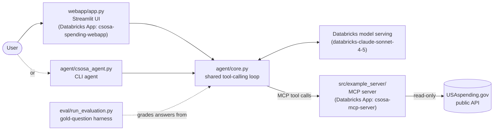

# CSOSA Spending Assistant — GSA MCP Hackathon

A ready-to-run starter for building a [Model Context Protocol (MCP)](https://modelcontextprotocol.io) server in Python, plus deployment kits for **IBM Cloud (watsonx Orchestrate)** and **Databricks**.

Built with [FastMCP](https://github.com/jlowin/fastmcp) and [uv](https://docs.astral.sh/uv/). If you have never built an MCP server before, start with **[QUICKSTART.md](QUICKSTART.md)**.

---

## Why this project

Built for the GSA MCP Hackathon to show what an MCP-enabled AI assistant can do with public federal data: instead of manually digging through USAspending.gov's search UI, a user asks a plain-language question — "What are CSOSA's largest security contracts?" — and gets back a narrated answer, a chart, and links back to the underlying award records. This instance is scoped to **CSOSA** (the Court Services and Offender Supervision Agency), but the same pattern — one MCP server, one agent loop, one web UI — applies to any agency's public spending data.

Every tool here is **read-only**: it retrieves, aggregates, and explains live USAspending.gov data. Nothing in this project writes back to USAspending.gov or any other external system.

### Live deployment (Databricks Apps)

| App | URL | What it is |
|---|---|---|
| CSOSA Spending Assistant (web UI) | https://csosa-spending-webapp-7474654188777746.aws.databricksapps.com | Ask a question in plain language, see the answer, chart, and sources |
| CSOSA MCP server | https://csosa-mcp-server-7474654188777746.aws.databricksapps.com/mcp | The underlying MCP tool server the assistant (and any MCP client) calls |

Both apps sit behind Databricks workspace SSO, so they're reachable by workspace members rather than the open internet — see [deploy/databricks/README.md](deploy/databricks/README.md) and [deploy/databricks-webapp/README.md](deploy/databricks-webapp/README.md) for how to deploy your own.

### Architecture



Two independently deployed Databricks Apps: the MCP server (5 read-only
CSOSA tools) and this web UI, which is just another MCP client. The CLI agent
and the eval harness are two more clients of the exact same `agent/core.py`
loop, so none of them can drift from each other.

### Try it yourself

Open the web UI (link above) and fill in the sidebar:

- **DATABRICKS_HOST:** `https://dbc-aae0ba16-8727.cloud.databricks.com`
- **MCP_SERVER_URL:** `https://csosa-mcp-server-7474654188777746.aws.databricksapps.com/mcp`
- **DATABRICKS_TOKEN:** run `databricks --profile <your-profile> auth token --host https://dbc-aae0ba16-8727.cloud.databricks.com --output json | python -c "import json,sys; print(json.load(sys.stdin)['access_token'])"` and paste the single line it prints (needs the Databricks CLI authenticated against this workspace; tokens expire in ~1 hour).

Then try these, in order — each one exercises a different feature:

1. **Fiscal-year trend + budget guardrail.** Ask `Show me CSOSA spending by fiscal year`, set **Budget threshold** to `50000000`. FY2010 (~$65.7M) should render as a red point on the line chart, with a dashed "Budget" line.
2. **Ranked bar chart + guardrail.** Ask `Who are CSOSA's top 5 recipients by total spending?`, set the threshold to `20000000`. Expect 3 red bars / 2 blue, a legend, and a hover tooltip naming the recipient and amount.
3. **Multi-turn memory.** Follow up in the *same* chat box with `What's the combined total of those five?` — it should answer directly from the previous turn's data, with no new "Discovered tools" status and no new chart.
4. **Source links.** Ask `What are CSOSA's three largest security-related contract awards?` — a chart plus a table with clickable "View on USAspending.gov" links.
5. **Award details.** Ask `Give me full contract details for CSOSA's largest fiscal year 2023 award` — no chart for this one, a raw JSON record under "Source data."
6. **Sub-awards.** Ask `Which sub-awardee received the largest sub-award amount under CSOSA prime contracts?`
7. **IDV chains.** Ask `Find CSOSA's largest award in fiscal year 2010, then show me the other orders placed under its parent IDV` — a multi-hop tool chain (search → details → IDV children).
8. **Reset.** Click **Clear conversation** in the sidebar.

Charts always render above the narrated answer, which renders above the raw source data — in that order, every time.

---

## What is an MCP server?

An MCP server exposes **tools** (functions the model can call), **prompts** (reusable conversation starters), and **resources** (data the model can read) to an AI client such as Claude Desktop, Claude Code, or an agent platform like watsonx Orchestrate. You write the tools; the client's model decides when to call them.

This template gives you a working server with one example of each, so you can replace the examples with your own service and deploy.

---

## Repo structure

```
mcp-hackathon-template/
├── README.md                  # This file
├── QUICKSTART.md              # 5-minute clone → run → connect walkthrough
├── main.py                    # Local entry point (uv run python main.py)
├── pyproject.toml             # Package + dependencies (uv)
├── requirements.txt           # Mirror of runtime deps (for buildpack hosts)
├── Dockerfile                 # Container image (streamable-HTTP, port 8080)
├── manifest.yaml              # cloud.gov (Cloud Foundry) deploy
├── server.json                # MCP registry metadata
├── .env.example               # Copy to .env for local dev
├── .github/workflows/ci.yml   # Lint + test on push/PR
├── src/
│   └── example_server/        # ← rename to your service
│       ├── app.py             # Thin entry point: builds FastMCP, picks transport
│       ├── config.py          # Settings from env vars / .env
│       ├── models.py          # Pydantic models & enums for tool params
│       ├── utils.py           # Shared helpers (HTTP client, pagination)
│       ├── routes.py          # HTTP-only routes (/health, /version)
│       ├── tools/             # ONE FILE PER TOOL
│       │   ├── __init__.py    #   register_tools(mcp) aggregator
│       │   └── example_tool.py
│       ├── prompts/
│       │   ├── __init__.py    #   register_prompts(mcp) aggregator
│       │   └── example.py
│       └── resources/
│           ├── __init__.py    #   register_resources(mcp) aggregator
│           └── example.py
├── tests/                     # Import + registration smoke tests
├── eval/                      # Stub → build a Phoenix eval harness (see mcp-eval skill)
└── deploy/
    ├── README.md              # Which deployment kit to use
    ├── ibm/                   # watsonx Orchestrate: 3 kits (see below)
    └── databricks/            # Databricks Apps kit
```

---

## Getting started

### Prerequisites
- [uv](https://docs.astral.sh/uv/) — `pip install uv` or `brew install uv`

### Install and run

```bash
cp .env.example .env
uv sync
uv run python main.py
```

The server starts in **stdio** mode — it talks JSON-RPC over stdin/stdout, which is how local clients (Claude Desktop, Claude Code) launch it. See [QUICKSTART.md](QUICKSTART.md) to connect a client.

### Verify

```bash
uv sync --group dev
uv run pytest tests/ -v      # tests
uv run ruff check .          # lint
```

---

## The one-tool-per-file pattern

Each tool lives in its own file under `src/example_server/tools/` and exposes a `register(mcp)` function. `tools/__init__.py` calls each one from a single `register_tools(mcp)`. This keeps the tool list scannable and lets you add or remove an integration by touching two files.

**Step 1 — create `src/example_server/tools/my_tool.py`:**

```python
from typing import Annotated
from urllib.parse import quote
from fastmcp import FastMCP

from example_server.utils import fetch_json


def register(mcp: FastMCP) -> None:
    @mcp.tool(
        name="example_get_thing",
        annotations={
            "title": "Get a thing",
            "readOnlyHint": True,
            "destructiveHint": False,
            "idempotentHint": True,
            "openWorldHint": True,
        },
    )
    async def get_thing(thing_id: Annotated[str, "The ID to fetch."]) -> dict:
        """One-line summary. Document the data source, its update cadence,
        and the return shape here — the model reads this docstring."""
        safe_id = quote(thing_id, safe="")
        return await fetch_json(f"things/{safe_id}")
```

**Step 2 — wire it up in `tools/__init__.py`:**

```python
from example_server.tools import example_tool, my_tool

def register_tools(mcp) -> None:
    example_tool.register(mcp)
    my_tool.register(mcp)  # ← add this line
```

**Step 3 — add any API key** as a typed field in `config.py` and document the env var in `.env.example`.

Prompts (`prompts/`) and resources (`resources/`) follow the exact same `register(mcp)` + aggregator pattern.

---

## Rename the package

Before publishing your server, rename `example_server` to your service (e.g. `census_mcp`):

1. Rename the folder `src/example_server/` → `src/<your_name>/`.
2. Update `pyproject.toml`: the `[project].name`, `[project.scripts]`, and `[tool.hatch.build.targets.wheel].packages`.
3. Find-and-replace `example_server` across `src/`, `tests/`, `main.py`, `Dockerfile`, and `manifest.yaml`.

---

## Tool design tips (federal data)

- **Return structured data, not prose.** Return dicts/lists with consistent keys and let the model narrate.
- **Document freshness.** Federal datasets lag; state the update frequency and "as-of" date in the docstring.
- **Expose pagination.** Use `PaginationParams` / `paginate()` from `utils.py`, and return `has_more` / `next_offset`.
- **Use explicit timeouts.** `utils.fetch_json` defaults to 30s.
- **Actionable errors.** Return an error dict with a `hint`, not a raw stack trace.
- **Constrain outbound requests.** Keep API origins in operator-controlled code or configuration, pass only validated relative paths to `fetch_json`, and encode path segments. Never pass a tool-supplied URL directly to an HTTP client.
- **Treat redirects and DNS as security boundaries.** Redirects are disabled by default. A server that must fetch caller-supplied URLs needs connection-time IP validation on every hop plus network egress controls; a one-time DNS check is not sufficient.
- **Keep sensitive data out of errors and logs.** Do not expose or log upstream bodies, headers, full URLs, query strings, credentials, stack traces, SSNs, dates of birth, or addresses.

---

## Deploying

Local development uses stdio. To share your server with an agent platform, deploy it and register it. See **[deploy/README.md](deploy/README.md)** for a chooser, then:

- **IBM watsonx Orchestrate** — [deploy/ibm/](deploy/ibm/) (three kits: local stdio toolkit, Code Engine build-from-Git, and prebuilt image).
- **Databricks Apps** — [deploy/databricks/](deploy/databricks/).

Both read the same server code; `app.py` automatically serves HTTP when the platform injects a port.

---

## Evaluations

Measuring how well an LLM can use your tools is the real test of server quality. This template intentionally does **not** ship an eval harness — see [eval/README.md](eval/README.md) for how to build one with the `mcp-eval` skill.

---

## License

[MIT](LICENSE). See [SECURITY.md](SECURITY.md) for the vulnerability disclosure policy and hackathon security notes.
